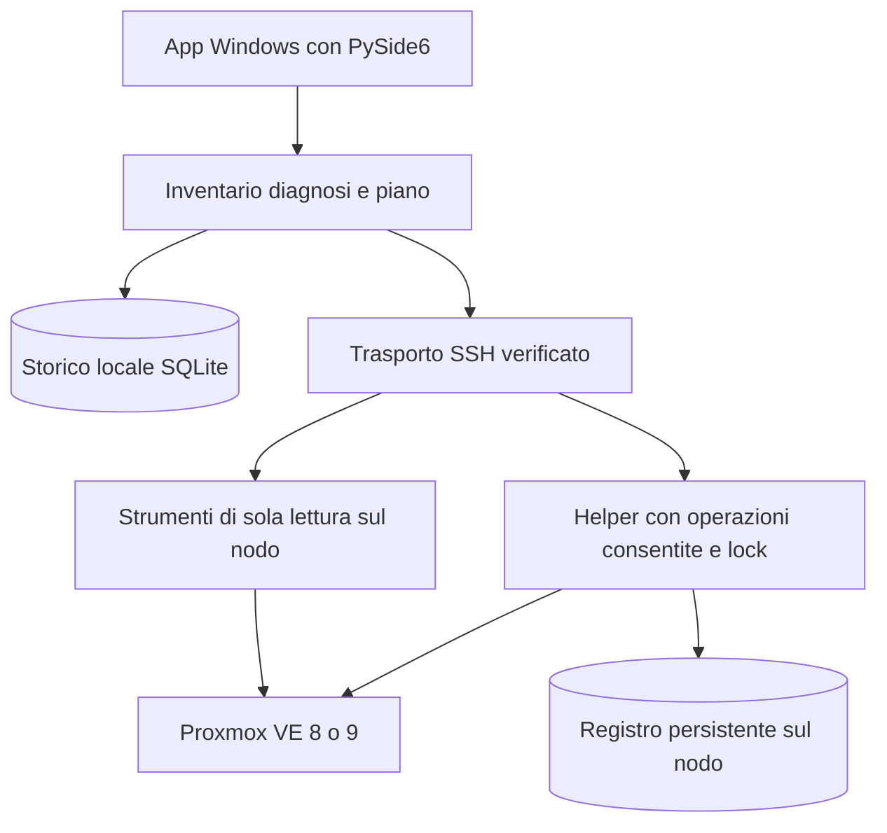
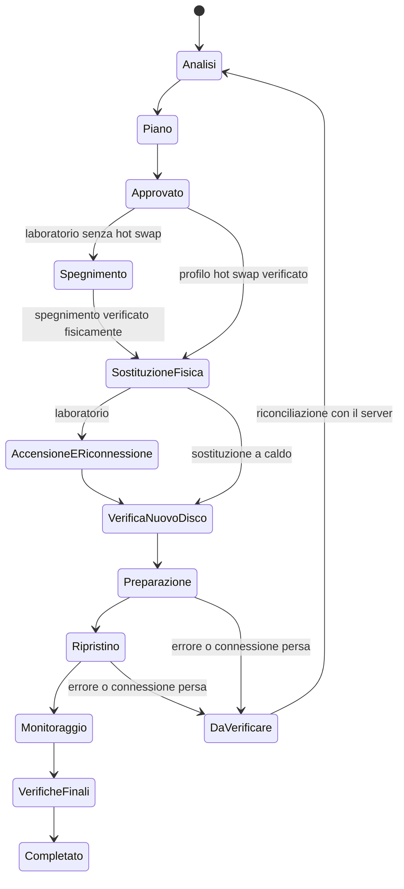

# Assistente desktop per la diagnosi e la sostituzione dei dischi ZFS in Proxmox

Documento di progetto — versione 0.6 — 2 novembre 2026<br>
Referente: Rudi Gomirato  
Nome provvisorio del repository: `proxmox-zfs-assistant`  
Destinazione prevista: account GitHub [Rudi-Gomirato](https://github.com/Rudi-Gomirato).

**Stato di implementazione:** disponibile la versione 0.2.0 della GUI Windows, del motore e dell'helper SSH. Sono presenti demo, test automatici, procedure per mirror e RAIDZ e script di build. L'aggiornamento aggiunge diagnosi EFI indipendente per entrambi i membri, ripristino della sola ESP selezionata, attesa del resilver prima dei passi EFI e registrazione delle prove fisiche di avvio. Il codice non è stato collegato a un host Proxmox reale durante questo sviluppo: compatibilità hardware, boot e LED restano da collaudare. Il presente documento conserva il disegno complessivo; per il comportamento effettivo e le limitazioni fanno riferimento [manuale](docs/manuale.md), [matrice di compatibilità](docs/compatibilita.md) e [changelog](CHANGELOG.md). La licenza MIT è stata confermata dal committente.

## 1 Obiettivo e decisioni iniziali

Realizzare un'applicazione desktop Windows in Python che si colleghi via SSH a un server Proxmox VE, analizzi lo stato di dischi e pool ZFS e accompagni un utente nella sostituzione di un disco. L'applicazione deve distinguere il ripristino dei dati ZFS dal ripristino dell'avvio del sistema e spiegare ogni comando prima della sua eventuale esecuzione.

La prima versione deve privilegiare un percorso breve e verificabile: diagnosi, identificazione fisica, piano di intervento, sostituzione, ricostruzione e verifica conclusiva. L'automazione riduce la digitazione dei comandi; le decisioni sul disco da rimuovere e sul nuovo disco da inizializzare restano esplicite.

Requisiti confermati dal committente:

| Aspetto | Configurazione iniziale |
| --- | --- |
| Interfaccia | Applicazione desktop Windows |
| Collegamento | SSH verso Proxmox |
| Versioni da supportare | Proxmox VE 8 e 9, su versioni puntuali da collaudare |
| Boot | Due SSD in mirror ZFS |
| Storage VM in laboratorio | Due dischi disponibili per il pool VM, in mirror ZFS |
| Storage VM in produzione | Mirror di due dischi oppure RAIDZ di tre dischi; tipo e parità da rilevare sul nodo |
| Hardware iniziale | Dischi collegati direttamente tramite cavi SATA |
| Sostituzione in laboratorio | PC senza hot swap, con spegnimento obbligatorio |
| Hardware di produzione dichiarato | Intel Xeon serie E-2300 e chipset Intel C252, con hot swap |
| Trasparenza | Mostrare i comandi e spiegare cosa fanno |
| Esecuzione | Guidata dall'app dopo approvazione del piano |
| Distribuzione | Progetto pubblico su GitHub |

È confermata l'esecuzione guidata dopo approvazione: l'app mostra e spiega i comandi e li esegue quando il piano è approvato e i controlli sono superati. La modalità solo istruzioni resta disponibile per consultazione e configurazioni non supportate.

Il laboratorio è un PC di modello non noto e senza hot swap. La produzione dispone di hot swap secondo quanto indicato dal committente; CPU e chipset sono noti, mentre modello esatto del server, scheda madre, backplane e disponibilità dei LED individuali restano da rilevare. Il supporto LED non viene dedotto dal nome del chipset.

Il boot resta previsto su un mirror separato di due SSD. Per il pool VM il laboratorio dispone soltanto di due dischi: la variante RAIDZ a tre dischi è un requisito di produzione e richiede un collaudo aggiuntivo. Il numero complessivo di dischi non deve essere fissato nel software.

Questo documento definisce il progetto e le sue estensioni. Non attesta compatibilità hardware già verificata; le procedure operative implementate sono descritte nel manuale.

## 2 Il vincolo del lampeggio sui dischi SATA

ZFS è il sistema software che gestisce la ridondanza e l'integrità dei dati. Il controller SATA fisico, i collegamenti e gli eventuali circuiti LED sono componenti distinti: usare RAID software non elimina il controller hardware.

Con il collegamento SATA diretto non si può dare per disponibile un LED di identificazione comandabile. Il primo prototipo dovrà verificare questa capacità sull'hardware di prova. `ledctl` supporta diversi meccanismi di controllo, ma il risultato dipende dall'hardware e dalla versione installata. [Documentazione upstream di ledctl](https://github.com/md-raid-utilities/ledmon/blob/main/doc/ledctl.pod).

Prevedere tre esiti nell'interfaccia:

1. **Identificazione LED disponibile e collaudata**: pulsante di identificazione temporizzata, con spegnimento e ripristino dello stato gestiti dall'applicazione.
2. **LED non disponibile**: mostrare seriale, modello, foto o schema del posizionamento ed etichetta fisica registrata in precedenza.
3. **Disco assente e posizione non documentata**: fermare la sostituzione guidata e richiedere identificazione fisica da parte di un tecnico.

Un eventuale LED di attività non equivale al LED di identificazione. Generare letture per provocarne il lampeggio non garantisce un risultato distinguibile, richiede che il disco risponda e può aggiungere carico a un dispositivo già problematico. Questa tecnica resta fuori dall'MVP; nessun test di identificazione deve scrivere dati sul disco.

Per il banco SATA diretto, il requisito realistico iniziale è identificare con certezza tramite seriale ed etichetta; il lampeggio è una capacità condizionata al collaudo hardware. Se è obbligatorio anche quando il disco non risponde, occorrerà un sistema di identificazione del vano indipendente dal disco, per esempio un enclosure compatibile.

### Profili hardware di laboratorio e produzione

| Profilo | Dati disponibili | Percorso fisico | Identificazione |
| --- | --- | --- | --- |
| Laboratorio | PC con collegamenti SATA diretti e due dischi per il pool VM, scheda madre non nota | Spegnimento prima di scollegare o collegare dischi | Seriale ed etichetta; LED solo se verificato |
| Produzione | Xeon serie E-2300, Intel C252, hot swap dichiarato | Sostituzione a caldo secondo procedura del server e verifiche iniziali | Backend LED e mappa vani da collaudare sul modello esatto |

Il profilo del server conserva separatamente capacità di hot swap, capacità LED e affidabilità della mappa fisica, insieme alla fonte e alla verifica effettuata. L'assenza di LED non disabilita il percorso guidato tramite seriali. Le prove sul PC di laboratorio non certificano il controllo dei vani o il comportamento hot swap dell'hardware di produzione.

## 3 Perimetro della prima versione

Il progetto gestisce un server alla volta, un pool di boot in mirror di due SSD, un pool VM in mirror di due dischi oppure RAIDZ di tre dischi e una sostituzione alla volta sull'intero host. Supporta inventario, diagnosi, rilevamento della topologia ZFS, classificazione dei dischi, identificazione, anteprima dei comandi e monitoraggio della ricostruzione, detta resilver. Il tipo di RAID e il ruolo boot/dati sono due decisioni indipendenti.

Il rilevamento deve distinguere mirror, RAIDZ1, RAIDZ2, RAIDZ3, dischi singoli e pool con più vdev, anche quando una configurazione non è ancora abilitata all'esecuzione. La dicitura generica RAIDZ a tre dischi non autorizza a presumere il livello di parità. Le varianti RAIDZ richieste fanno parte del progetto; l'esecuzione viene abilitata per la combinazione effettivamente rilevata dopo il relativo collaudo.

Per il boot automatizza inizialmente soltanto i layout e i metodi di avvio provati in laboratorio. Il rilevamento di una configurazione diversa deve produrre un resoconto e un blocco motivato dell'esecuzione.

Non rientrano nell'automazione iniziale dRAID, multipath, hardware RAID, pool non ridondati, vdev speciali, log, cache, spare attivi, pool con più vdev dati o altri layout non ancora collaudati. Questi elementi devono comunque essere rilevati per evitare di trattarli come normali membri di un mirror o RAIDZ. Restano fuori anche ricostruzione di pool perduti e recupero di un host che non si avvia: in questi casi SSH non è disponibile.

Le altre diagnosi Proxmox, come servizi, rete, capacità e memoria, potranno essere aggiunte come moduli successivi. Il primo rilascio concentra il lavoro sui dischi.

## 4 Riconoscere disco fisico e funzione

Il modello non deve assegnare un solo ruolo a un disco. Occorre rappresentare separatamente:

- disco fisico, seriale, WWN ove presente e percorso stabile;
- partizioni, tipi GPT, UUID e dipendenze dal dispositivo fisico;
- appartenenze a pool e vdev, con GUID e funzione del vdev;
- filesystem root e componenti di avvio;
- storage Proxmox e relativi dataset o percorsi;
- posizione fisica, fonte dell'associazione e data dell'ultima verifica.

Il nome `rpool` e l'etichetta `local-zfs` non devono decidere il percorso di sostituzione. La configurazione standard può collocare sistema e immagini VM nello stesso pool. [Documentazione Proxmox su ZFS](https://github.com/proxmox/pve-docs/blob/master/local-zfs.adoc).

Algoritmo proposto:

1. Individuare il filesystem che contiene `/` e risalire al pool o ai dispositivi sottostanti.
2. Rilevare ESP, eventuale partizione BIOS boot, `/boot`, configurazione del bootloader e stato di `proxmox-boot-tool`.
3. Risolvere ogni membro ZFS fino al disco fisico, conservando anche partizione e GUID del vdev.
4. Leggere la configurazione storage Proxmox, rispettando eventuali restrizioni per nodo, e associare dataset e mountpoint ai pool.
5. Assegnare i ruoli `BOOT`, `DATI_VM`, `MISTO`, `ALTRO` o `SCONOSCIUTO`, mantenendo le prove che li giustificano.

Un disco necessario all'avvio segue sempre il percorso boot, anche se contiene VM. Un disco che serve più pool o funzioni non previste dall'MVP produce un piano informativo e richiede una procedura specifica. Con classificazione ambigua, nessuna inizializzazione o modifica automatica.

### Rilevamento del tipo di RAID ZFS

Il rilevamento ricostruisce l'albero pool → vdev dati → membri, usando l'output strutturato disponibile oppure il parser testuale collaudato. Conserva GUID, tipo, numero di membri configurati, membri presenti e stato di ciascuno. Un disco assente resta parte della topologia configurata: un RAIDZ di tre membri con uno assente non deve diventare un presunto mirror a due dischi. La struttura è esposta da `zpool status`; la modalità JSON dipende dalla versione installata. [Manuale zpool status](https://openzfs.github.io/openzfs-docs/man/master/8/zpool-status.8.html).

Per ogni vdev registrare tipo normalizzato, livello di parità se applicabile, elenco completo dei membri, eventuali gruppi temporanei di sostituzione, stato di ricostruzione e fonte del rilevamento. I nomi sintetici come `raidz1-0` sono interpretati nel contesto dell'albero, senza confonderli con il nome del pool.

Il motore usa queste distinzioni:

| Topologia rilevata | Ridondanza nominale del singolo vdev | Decisione progettuale |
| --- | --- | --- |
| Mirror di due dischi | Due copie, tollera la perdita completa di un membro | Percorso boot o VM secondo il ruolo |
| RAIDZ1 | Una parità, tollera la perdita completa di un membro | Percorso VM RAIDZ con controlli dei membri rimanenti |
| RAIDZ2 | Due parità, tollera la perdita completa di due membri | Rilevare esplicitamente e abilitare solo il layout collaudato |
| RAIDZ3 | Tre parità, tollera la perdita completa di tre membri | Rilevare esplicitamente e abilitare solo il layout collaudato |
| Disco singolo o stripe senza ridondanza | Nessuna tolleranza alla perdita di un membro | Diagnosi e percorso dedicato, senza sostituzione automatica ordinaria |
| Più vdev o struttura non riconosciuta | Dipende da ogni vdev | Mostrare l'albero e bloccare i passi non supportati |

Le tolleranze indicate descrivono la ridondanza nominale, non garantiscono la leggibilità dei dati in presenza di ulteriori errori. Il numero di dischi da solo non identifica il RAID. [Concetti OpenZFS su mirror e RAIDZ](https://openzfs.github.io/openzfs-docs/man/master/7/zpoolconcepts.7.html).

Se il rilevamento fallisce o è ambiguo, la GUI deve chiedere all'utente quale configurazione si aspetta: **mirror**, **RAIDZ con livello di parità**, **altra configurazione** oppure **non lo so**. Deve indicare il pool interessato, mostrare i dati raccolti e spiegare cosa manca, per esempio un permesso di lettura o un output non riconosciuto. Offre quindi una nuova lettura o l'acquisizione dell'output diagnostico completo.

La risposta dell'utente viene conservata come dichiarazione da confrontare con la topologia rilevata. Non sostituisce la verifica tecnica e non abilita da sola comandi modificativi. Una discrepanza tra dichiarazione e rilevamento apre una richiesta di chiarimento; la topologia resta non verificata finché i dati del nodo non la confermano. In caso di risposta non lo so, l'app mantiene diagnosi e raccolta dati disponibili e descrive le informazioni necessarie per proseguire.

## 5 Diagnosi e interpretazione degli stati

L'app conserva l'output originale e distingue stato del pool, stato del vdev, contatori di errore e salute del dispositivo. Non deve assumere che tutti i termini siano stati nativi ZFS: per esempio `ERROR` può essere una categoria dell'app, mentre `UNAVAIL` è una denominazione ZFS. Gli stati sono contestualizzati secondo la documentazione OpenZFS. [Concetti e stati dei pool](https://openzfs.github.io/openzfs-docs/man/master/7/zpoolconcepts.7.html).

| Evidenza | Interpretazione nell'app | Comportamento proposto |
| --- | --- | --- |
| `ONLINE` senza altri segnali | Nessun problema rilevato dai controlli disponibili | Monitorare |
| `ONLINE` con errori o allarmi SMART | Anomalia da approfondire | Confrontare storico e log |
| `DEGRADED` | Ridondanza ridotta | Analizzare quali membri restano leggibili |
| `FAULTED` | Dispositivo dichiarato guasto da ZFS | Proporre verifica e piano se la ridondanza del vdev lo consente |
| `UNAVAIL` o dispositivo assente | Accesso al membro non disponibile | Verificare anche cavo, alimentazione e controller |
| `OFFLINE` | Membro escluso, potenzialmente per scelta amministrativa | Ricostruire il contesto prima della sostituzione |
| `REMOVED`, ove riportato | Rimozione rilevata | Confrontare inventario precedente e posizione |
| Stato sconosciuto o parsing incompleto | Diagnosi non affidabile | Bloccare le modifiche |

La diagnosi deve distinguere disco probabilmente guasto, collegamento sospetto, esclusione amministrativa e problema non determinato. Gli errori di checksum non dimostrano da soli un guasto al disco; SMART senza allarmi non esclude problemi.

Raccogliere contatori ZFS, dati SMART disponibili, usura SSD, temperature, errori di collegamento e messaggi del kernel. Conservare i valori grezzi e le variazioni; evitare soglie universali per attributi dipendenti dal produttore. Non avviare automaticamente test SMART lunghi o scrub mentre il vdev è degradato.

## 6 Architettura Python proposta

Python è adatto al coordinamento, alla GUI e alla gestione dei dati. Le operazioni ZFS e di boot devono usare gli strumenti del server attraverso adattatori controllati.

| Componente | Scelta proposta | Motivazione |
| --- | --- | --- |
| GUI Windows | PySide6 | Interfaccia desktop Qt con tabelle e procedura guidata |
| SSH | Paramiko | Connessione, controllo chiave host, canali e trasferimenti |
| Dominio | Modelli Python tipizzati | Separare dati, diagnosi e decisioni dalla GUI |
| Persistenza Windows | SQLite | Profili server, inventario e cronologia interventi |
| Esecutore privilegiato | Piccolo helper sul nodo per la fase operativa | Validare operazioni e serializzare gli interventi |
| Collaudo | pytest e fixture anonimizzate | Riprodurre stati e verificare le condizioni di blocco |
| Distribuzione | Pacchetto Windows con runtime incluso | Evitare installazione manuale di Python all'utente |

PySide6 e Paramiko sono proposte fondate sulle rispettive documentazioni; versioni, dipendenze e obblighi di distribuzione saranno fissati prima del packaging. [Qt for Python](https://doc.qt.io/qtforpython-6/), [Paramiko SSHClient](https://docs.paramiko.org/en/stable/api/client.html).



La prima fase diagnostica usa SSH senza un servizio web e senza un demone applicativo permanente. La fase esecutiva introduce un helper installato esplicitamente, con protocollo JSON su standard input/output, versione dichiarata e registro persistente. Non si deve dipendere da una sessione GUI aperta per conoscere l'esito di un'operazione.

L'helper accetta operazioni definite, non stringhe arbitrarie di shell. Il frontend mostra il comando nativo risolto, la spiegazione, il disco di destinazione e gli effetti attesi. Le operazioni di rete e il monitoraggio lavorano fuori dal thread grafico.

Il progetto usa [jt-proxense](https://github.com/jasoncheng7115/jt-proxense) come riferimento funzionale e visivo, con le scelte descritte nella sezione 19. Resta confermata l'app desktop Windows in PySide6 con collegamento SSH. Un eventuale adattatore Proxmox API per metriche e inventario sarà un'estensione separata: non diventa un requisito per il percorso iniziale e non sostituisce le verifiche sul nodo prima delle scritture.

## 7 Raccolta dati e compatibilità

All'accesso rilevare release Proxmox, versione OpenZFS, kernel, architettura e strumenti disponibili. Il supporto viene dichiarato per combinazioni collaudate di versioni, layout e hardware; non basta riconoscere il numero principale 8 o 9.

| Strumento o sorgente | Informazioni richieste |
| --- | --- |
| `pveversion -v` | Ambiente software effettivo |
| `zpool status`, `zpool list`, `zpool get` | Topologia, GUID, salute, proprietà e ricostruzione |
| `zfs list` e proprietà dei dataset | Root, dataset e mountpoint |
| `lsblk`, `findmnt`, `udevadm` e sysfs | Dischi, partizioni, identità e dipendenze |
| `smartctl` | Dati diagnostici del dispositivo |
| `proxmox-boot-tool status` e configurazione boot | ESP e metodo di avvio |
| `/etc/pve/storage.cfg` e inventario VM/CT | Relazione tra storage, pool e carichi coinvolti |
| Journal del kernel | Reset, timeout ed errori del collegamento |

Preferire JSON quando lo strumento installato lo supporta. Per `zpool status`, il supporto JSON va verificato a runtime; mantenere un parser testuale con locale controllato, output grezzo e fixture per le versioni supportate. GUID, percorsi completi e risoluzione dei link devono essere raccolti senza perdere le associazioni. [Manuale zpool status](https://openzfs.github.io/openzfs-docs/man/master/8/zpool-status.8.html).

Per `lsblk` indicare esplicitamente le colonne; per SMART distinguere codici di uscita diagnostici da errori di esecuzione, poiché l'exit status è una maschera di bit. [Manuale upstream smartctl](https://github.com/smartmontools/smartmontools/blob/master/smartmontools/smartctl.8.in).

Una raccolta incompleta deve essere visibile. L'assenza di privilegi o di uno strumento non equivale a un disco sano e non deve provocare installazioni automatiche o modifiche alla configurazione del server.

## 8 Identificazione fisica e inventario preventivo

Durante la prima configurazione, registrare per ogni disco rilevato seriale completo, percorso stabile, ruolo e posizione. Per esempio `BOOT A`, `BOOT B`, `VM A`, `VM B` ed eventualmente `VM C`, con etichette sui supporti e sui cavi e una foto facoltativa. L'inventario segue il numero reale di membri, senza presumerne quattro sull'intero host.

L'associazione deve riportare se deriva da enclosure, percorso hardware o verifica manuale. Un percorso SATA non prova da solo quale sia il disco fisico dopo uno spostamento dei cavi. Se cambiano topologia o componenti, la mappa va riconfermata.

Per hardware futuro con enclosure, un adattatore SES può associare identità e vano ed eseguire la richiesta `ident`; l'indice interno dell'elemento SES non va confuso con il numero stampato sul vano. La mappatura va provata sul modello specifico. [Documentazione dell'autore di sg_ses](https://sg.danny.cz/sg/sg_ses.html).

L'adattatore LED deve operare solo sul bersaglio e spegnere soltanto l'identificazione da esso attivata, senza cancellare un allarme guasto. Per `ledctl` verificare il supporto a limitare gli effetti ai dispositivi elencati; il successo del comando non sostituisce il collaudo visivo iniziale. Gestire durata limitata, arresto e riconnessione.

## 9 Interfaccia e percorso dell'utente

Schermate previste:

1. **Connessione**: server, porta SSH, utente, chiave o credenziale e verifica dell'impronta host.
2. **Stato server**: riquadri distinti per boot e VM, tipo di RAID, membri configurati e presenti, salute, anomalie e limiti dei controlli. Se il tipo non è determinabile, avviare la domanda all'utente.
3. **Dischi**: modello, seriale, posizione, stato ZFS, SMART e ruoli.
4. **Analisi del problema**: evidenze, probabilità qualitativa e controlli suggeriti.
5. **Sostituzione guidata**: topologia verificata, vecchio disco, membri rimanenti, posizione e nuovo disco.
6. **Comandi e spiegazioni**: anteprima del piano, approvazione ed esecuzione guidata dei passi supportati.
7. **Avanzamento**: esito di ogni passo, resilver e verifiche ancora aperte.
8. **Rapporto finale**: risultato, azioni residue ed esportazione anonimizzata.

Ogni comando mostra scopo, privilegi richiesti, sorgente, destinazione, effetto sui dati e condizione di successo. L'utente non deve ricopiare seriali o percorsi: li seleziona dall'inventario e li riconosce nel riepilogo.

Per limitare le interazioni si approva il piano iniziale e si richiede una nuova conferma solo quando il nuovo disco è stato effettivamente inserito e identificato o quando il piano cambia. Le riletture e il monitoraggio non richiedono conferme ripetute. Se viene scelta la modalità solo istruzioni, l'applicazione non esegue comandi modificativi.

Nel profilo laboratorio, il percorso mostra anche le fasi **Arresto dei carichi**, **Spegnimento**, **Sostituzione a PC spento**, **Accensione manuale** e **Riconnessione**. L'utente non deve tornare a una shell per riprendere l'intervento. L'app spiega prima dello spegnimento quali attività riprenderanno dopo il riavvio.

### Vista grafica ispirata a jt proxense

La finestra principale propone una barra laterale con **Panoramica**, **Pool e dischi**, **Diagnosi**, **Interventi** e **Impostazioni**. In alto mostra il server selezionato, connessione SSH, profilo laboratorio o produzione e istante dell'ultima lettura riuscita.

La vista Pool e dischi rappresenta ogni pool come albero navigabile: pool → vdev con tipo e parità → dischi con seriale, ruolo e stato. Un disco assente resta visibile nella sua posizione logica. Selezionando un membro si apre il dettaglio con identità fisica, evidenze diagnostiche, posizione e azioni consentite. La configurazione RAID sconosciuta offre direttamente la richiesta di chiarimento prevista nella sezione 4.

Il pannello della sostituzione presenta, nello stesso contesto, topologia, controlli preliminari con esito e motivo, disco da sostituire, destinazione e comandi spiegati. Il pulsante di esecuzione è disponibile quando piano e bersaglio sono approvati e i prerequisiti risultano verificati.

La panoramica mostra anche quali storage Proxmox e quali VM o container dipendono dal pool, esplicitando eventuali relazioni non risolte. L'app distingue elenco dei carichi dipendenti e impatto previsto dello specifico intervento: sostituire un membro non implica automaticamente perdere tutti i carichi elencati.

Per l'aspetto si propone un tema scuro con accenti discreti, affiancato da un tema chiaro. Stato e gravità devono essere leggibili anche tramite testo e simboli. Numeri, seriali e comandi richiedono contrasto elevato e caratteri leggibili; effetti decorativi e animazioni non devono ostacolare il riconoscimento del disco o la lettura del piano. È un adattamento progettuale alla manutenzione guidata, non una replica dell'interfaccia del riferimento.

Il pannello Interventi mantiene la cronologia e una vista persistente del resilver: stato reale, ultimo campione, errori, stima di completamento e attività ancora da verificare. La perdita della connessione produce lo stato dati non aggiornati, senza continuare a mostrare come attuale l'ultimo stato sano.

## 10 Regole prima di ogni modifica

Il motore deve verificare sul server, immediatamente prima dell'azione:

- identità di host, pool, vdev e dischi coerente con il piano approvato;
- topologia ZFS verificata e ridondanza residua coerente con il vdev: copia disponibile nel mirror oppure ricostruibilità mediante membri e parità del RAIDZ, senza ulteriori anomalie bloccanti;
- nessun altro intervento concorrente o ricostruzione incompatibile;
- nuovo disco diverso sia dal guasto sia da qualsiasi altro membro di qualunque pool;
- capacità utile in byte sufficiente e geometria compatibile con il layout previsto;
- assenza di mount, swap, holder, appartenenze o firme non spiegate sul bersaglio;
- classificazione boot/dati e strategia di sostituzione supportate;
- piano coerente con hot swap effettivo oppure con spegnimento;
- stato dei backup noto e conferma del piano di manutenzione da parte dell'operatore.

Il controllo delle firme non dimostra che un disco sia vuoto: la destinazione va comunque riconosciuta e approvata. Nell'MVP, dischi con firme esistenti richiedono una preparazione separata; nessuna cancellazione automatica.

Vietare nell'esecuzione ordinaria `zpool destroy`, `zpool add`, `zpool detach`, cancellazioni generiche e uso automatico di opzioni di forzatura. `zpool replace -f` può forzare l'uso di un dispositivo apparentemente occupato: non deve essere un tentativo automatico dopo un errore. [Manuale zpool replace](https://openzfs.github.io/openzfs-docs/man/master/8/zpool-replace.8.html).

Ulteriori problemi dei membri rimanenti, un'identità dubbia o un mutamento della topologia interrompono il piano e producono una spiegazione concreta. La ridondanza non viene stimata soltanto contando i dischi visibili. Non tentare di ripristinare automaticamente il layout precedente dopo un errore parziale.

## 11 Sostituzione di un membro del pool VM

Sequenza proposta:

1. Acquisire inventario e diagnostica, rilevare il tipo di RAID e identificare il membro guasto. Verificare tutti i membri rimanenti e l'appartenenza al vdev; se la topologia non è determinabile, chiedere all'utente come descritto nella sezione 4 e completare la verifica prima delle modifiche.
2. Determinare quali VM e container usano lo storage e pianificare eventuale fermo o migrazione. L'MVP non migra automaticamente i carichi.
3. Identificare fisicamente il disco, mostrare e approvare il piano.
4. Se necessario, escludere logicamente il membro ancora presente soltanto secondo la procedura collaudata. Un disco già assente non richiede un tentativo indiscriminato di offline.
5. Sostituire il disco con il percorso hot swap o a server spento.
6. Rilevare il nuovo seriale e verificare dimensioni, firme e destinazione.
7. Eseguire la sostituzione ZFS usando il GUID del vecchio vdev e il percorso stabile del nuovo dispositivo o della sua partizione, secondo il layout rilevato.
8. Monitorare la ricostruzione e verificare salute e dati dopo il completamento.

Per un membro dati privo di componenti di avvio non si inizializzano ESP né bootloader. Un vdev basato su partizioni richiede una preparazione coerente con quel layout; non va sostituito usando automaticamente l'intero disco.

### Differenze tra mirror e RAIDZ nel percorso VM

Nel mirror di due dischi si controlla il membro rimasto e si ricostituisce la copia sul nuovo dispositivo. Nel RAIDZ si verifica l'intero gruppo, il livello di parità e quali membri risultano indisponibili o presentano errori. La perdita nominalmente tollerata dal gruppo non è un'autorizzazione a rimuovere un altro disco quando un membro è già guasto.

Il piano RAIDZ sostituisce il membro del vdev esistente tramite `zpool replace`, conservando la topologia. Non converte il RAID, non aggiunge un nuovo vdev e non esegue detach del vecchio membro come se fosse un mirror. Non seleziona la ricostruzione sequenziale con `zpool replace -s`, che non è supportata per RAIDZ. [Manuale zpool replace](https://openzfs.github.io/openzfs-docs/man/master/8/zpool-replace.8.html).

Per il primo rilascio esecutivo RAIDZ si ammette un solo membro da sostituire e nessun ulteriore guasto o errore bloccante nei membri rimanenti; i casi multipli richiedono una procedura dedicata anche quando la parità nominale offrirebbe ulteriore tolleranza. Il riepilogo espone, per esempio, pool VM, RAIDZ1, tre membri configurati, due accessibili e uno guasto. Durante e dopo il resilver si controllano tutti i membri e gli errori permanenti.

Il percorso con server spento salva il piano prima dello shutdown. L'app attende l'assenza e il successivo ritorno del server, verifica la chiave SSH e ricostruisce l'inventario prima di proseguire. Lo spegnimento deve tenere conto dei carichi e dell'eventuale appartenenza a un cluster.

Nel laboratorio questo percorso è obbligatorio per ogni sostituzione fisica, sia del pool VM sia del boot. L'app mantiene visibili localmente seriale, etichetta e istruzioni mentre il server è spento. La perdita di SSH non prova che il PC sia spento: prima di toccare i collegamenti l'operatore deve verificarne fisicamente lo spegnimento. Il piano include l'arresto ordinato dei carichi coinvolti e dell'host; l'accensione è manuale, poiché non è stato indicato un sistema di gestione remota dell'alimentazione.

In produzione si usa il percorso hot swap dichiarato, una volta documentati procedura del modello e mappa dei vani. Il piano non presume che disponibilità hot swap e comando LED siano la stessa capacità. Dopo l'inserimento si ricontrolla sempre l'identità del nuovo disco.

## 12 Sostituzione di un membro del mirror di boot

Questo percorso comprende due risultati distinti: ridondanza ZFS ripristinata e componenti di avvio predisposti sul nuovo disco.

La procedura ufficiale Proxmox prevede la replica del partizionamento da un disco sano, la rigenerazione dei GUID e la sostituzione della partizione ZFS, seguite dalla preparazione del boot secondo il metodo in uso. Il progetto deve rilevare il layout effettivo e non fissare numeri di partizione nel codice. [Procedura Proxmox per dispositivi guasti e di boot](https://github.com/proxmox/pve-docs/blob/master/local-zfs.adoc#changing-a-failed-device).

Passi progettati:

1. Identificare il membro sano da usare come riferimento e verificare layout, capacità e metodo di avvio.
2. Salvare inventario, tabella partizioni di riferimento e piano con sorgente e destinazione chiaramente separate.
3. Effettuare la sostituzione fisica secondo il profilo: spegnimento obbligatorio nel laboratorio, percorso hot swap previsto e verificato per la produzione.
4. Verificare il nuovo disco e applicare il partizionamento approvato, con GUID rigenerati sul solo disco nuovo.
5. Attendere il riconoscimento delle partizioni e ricontrollarne identità, tipo e dimensioni.
6. Sostituire il vecchio membro ZFS con la partizione corretta del nuovo SSD.
7. Predisporre ESP e bootloader in base alla strategia rilevata.
8. Monitorare ZFS e verificare separatamente la configurazione di avvio.

| Metodo rilevato | Strategia |
| --- | --- |
| `proxmox-boot-tool` con systemd-boot | Preparazione ESP e inizializzazione coerente con i membri esistenti |
| `proxmox-boot-tool` con GRUB | Preparazione ESP e inizializzazione esplicita nella modalità GRUB |
| GRUB senza gestione tramite `proxmox-boot-tool` | Procedura dedicata, inizialmente soltanto istruzioni |
| Layout o metodo non riconosciuto | Blocco dell'esecuzione |

`proxmox-boot-tool` mantiene le ESP sincronizzate e consente inizializzazione con GRUB; la scelta deve rispettare anche Secure Boot. Il solo firmware UEFI non basta a dedurre il bootloader. [Documentazione Proxmox sull'avvio](https://github.com/proxmox/pve-docs/blob/master/system-booting.adoc).

Il rapporto finale deve separare **pool ricostruito**, **configurazione di avvio verificata** e **avvio dal nuovo disco provato**. L'ultima voce richiede una prova controllata in manutenzione; non si può dedurre dal solo successo dei comandi. Nessun riavvio automatico per collaudare il boot.

## 13 Anteprima dei comandi

Gli esempi seguenti sono modelli illustrativi con segnaposto, non uno script da eseguire. L'app deve sostituire i segnaposto solo con oggetti dell'inventario verificati e costruire il piano specifico.

| Modello di comando | Spiegazione per l'utente |
| --- | --- |
| `zpool status -v <POOL>` | Legge stato e avanzamento e mostra eventuali errori permanenti |
| `smartctl -a -j <DISCO>` | Legge le informazioni SMART disponibili in JSON |
| `zpool offline <POOL> <GUID_VECCHIO>` | Esclude logicamente il membro selezionato, solo se il piano lo richiede |
| `zpool replace <POOL> <GUID_VECCHIO> <NUOVO_MEMBRO>` | Inserisce il nuovo membro al posto del precedente e avvia la ricostruzione |
| `sgdisk <DISCO_SANO> -R <DISCO_NUOVO>` | Replica la tabella partizioni dal disco sano al disco nuovo; sovrascrive la tabella sul nuovo |
| `sgdisk -G <DISCO_NUOVO>` | Rigenera i GUID della tabella e delle partizioni sul nuovo disco |
| `proxmox-boot-tool format <ESP_NUOVA>` | Formatta esclusivamente l'ESP nuova approvata |
| `proxmox-boot-tool init <ESP_NUOVA>` | Inizializza l'ESP nella modalità systemd-boot prevista dal piano |
| `proxmox-boot-tool init <ESP_NUOVA> grub` | Inizializza l'ESP nella modalità GRUB prevista dal piano |
| `proxmox-boot-tool status` | Controlla lo stato delle ESP gestite |

L'anteprima evidenzia in particolare la direzione di copia di `sgdisk`: il disco sano è la sorgente e quello nuovo la destinazione. Le varianti di inizializzazione boot sono alternative decise dal piano, non passi da lanciare entrambi.

I comandi modificativi hanno prerequisiti e controlli successivi. Non basta l'exit code zero: dopo il partizionamento si rilegge la tabella, dopo la sostituzione si verifica il nuovo membro, dopo l'inizializzazione si controlla l'ESP.

L'anteprima del piano viene generata dall'app e accompagnata da verifiche di sola lettura. Non va presentata come una simulazione nativa universale: usare un dry run dello strumento solo quando la specifica operazione e la versione lo prevedono. In particolare, non inventare un'opzione `-n` per `zpool replace`, che non la espone nella sintassi documentata. [Sintassi di zpool replace](https://openzfs.github.io/openzfs-docs/man/master/8/zpool-replace.8.html).

## 14 Esecuzione affidabile e gestione delle interruzioni

Ogni intervento ha un identificativo e una macchina a stati persistente:



Il piano approvato contiene identità, topologia osservata, versione del motore e azioni previste. Un lock sul nodo impedisce due operazioni applicative simultanee; le verifiche proteggono anche dai cambiamenti eseguiti da altri amministratori.

Chiudere Windows o perdere SSH non equivale a fermare ZFS. Alla riconnessione l'app interroga il registro del nodo e lo stato reale prima di decidere il passo successivo. Un comando con esito ignoto non viene rilanciato alla cieca. La formattazione ESP e la replica GPT non devono essere ripetute automaticamente.

Il pulsante di arresto sospende i passi futuri del piano; durante una ricostruzione informa che ZFS continua a lavorare. Non promettere annullamento di modifiche già applicate. L'ETA del resilver viene mostrata come stima, non come tempo garantito.

## 15 Accesso SSH e privilegi

Verificare l'impronta del server al primo collegamento e conservarla; una chiave cambiata richiede verifica esplicita. Preferire chiavi SSH e agente locale, senza memorizzare password nel progetto o nei log.

La modalità diagnostica usa i soli privilegi necessari alle singole letture. La modalità esecutiva usa un helper con azioni ammesse e controllo degli argomenti; una regola `sudo` non deve autorizzare una shell generica o script modificabili dall'utente non privilegiato. Percorso assoluto, proprietario e permessi dell'helper fanno parte del collaudo.

L'helper riceve strutture JSON, risolve le identità sul nodo ed esegue processi con argomenti separati e senza shell. Anche il comando SSH che lo invoca resta fisso, senza concatenare nomi di pool o percorsi forniti dalla GUI.

Il registro comprende autore, host, piano, seriali coinvolti, comandi risolti, timestamp ed esiti. La copia locale e quella sul nodo consentono la riconciliazione; non vanno presentate come registri impossibili da alterare. Gli export pubblici mascherano indirizzi, nomi VM, seriali e altri dati identificativi, mantenendo coerenti le relazioni.

## 16 Piano di implementazione

Le durate sono stime iniziali di sviluppo per una persona, con hardware disponibile; non includono l'attesa dei resilver e dei test estesi. Verranno riviste dopo la raccolta dei primi inventari reali.

| Fase | Risultato concreto | Criterio per passare alla fase successiva | Stima |
| --- | --- | --- | --- |
| 0 Laboratorio e specifiche | Inventari reali PVE 8/9, mappa dei dischi disponibili e profilo senza hot swap; inventario hardware di produzione | Mirror VM a due dischi documentato e piano per i test RAIDZ | 2–4 giorni |
| 1 Diagnostica | Connessione SSH, inventario, ruoli e topologia per vdev | Distingue mirror e livelli RAIDZ; chiede chiarimenti quando il rilevamento è incompleto | 6–10 giorni |
| 2 GUI e piano | Dashboard, albero pool e vdev, inventario dischi, carichi dipendenti e anteprima spiegata | Un utente individua disco, tipo RAID e azioni senza scrivere comandi | 5–9 giorni |
| 3 Pool VM mirror e RAIDZ | Helper, strategie per tipo di vdev e sostituzione con ripresa | Mirror provato sul PC disponibile; RAIDZ su ambiente aggiuntivo prima dell'abilitazione | 7–12 giorni |
| 4 Mirror boot | Partizioni, boot e recupero del flusso | Ricostruzione e avvio separato provati | 6–10 giorni |
| 5 Robustezza | Ripresa dopo interruzioni, controlli concorrenti e percorso hot swap su hardware rappresentativo | Nessuna ripetizione distruttiva; capacità LED e hot swap collaudate separatamente | 4–7 giorni |
| 6 Rilascio pubblico | Pacchetto Windows, manuali e repository | Installazione riproducibile su Windows pulito | 3–5 giorni |

Ordine raccomandato: prima diagnosi reale, rilevamento RAID e identificazione SATA, poi piano trasparente, quindi esecuzione per VM e infine per il boot. La diagnostica RAIDZ entra dalla fase 1; l'esecuzione RAIDZ richiede il suo collaudo. Il primo risultato utile è già disponibile alla fase 2.

## 17 Collaudo e criteri di accettazione

Le prove modificative usano esclusivamente un laboratorio con dati sacrificabili. I test virtuali verificano il motore e i parser; LED, scollegamento SATA e avvio dal nuovo disco richiedono hardware reale.

I due dischi VM disponibili coprono il mirror con spegnimento. Le prove del boot seguono il relativo mirror quando disponibile nel banco di prova. Per RAIDZ prevedere dapprima una VM Proxmox di laboratorio con tre dischi virtuali indipendenti e sacrificabili, per verificare riconoscimento, sostituzione e ripresa; questi test non certificano guasti fisici, LED o hot swap. Il percorso RAIDZ su hardware reale, il percorso a caldo e il backend LED richiedono in seguito hardware rappresentativo predisposto con dati sacrificabili; non si simulano guasti distruttivi sui server che ospitano VM operative.

| Scenario | Risultato atteso |
| --- | --- |
| Mirror VM con due dischi sani | Due membri riconosciuti come mirror, senza assumere un totale fisso di dischi sull'host |
| Boot mirror e VM separato | Ruoli distinti corretti anche con numero di membri VM diverso |
| RAIDZ1 VM di tre dischi | Tipo, parità e tre membri configurati riconosciuti |
| RAIDZ con un membro assente | Topologia originale conservata, senza classificarlo dal solo numero dei dischi presenti |
| RAIDZ2 o RAIDZ3 rilevato | Livello esatto mostrato e stato di supporto esecutivo esplicito |
| Due dischi VM senza mirror oppure pool con più vdev | Nessuna inferenza del RAID dal conteggio, passi non supportati bloccati |
| Tipo di RAID non determinabile | Domanda all'utente con opzione non lo so e richiesta dei dati mancanti |
| Dichiarazione utente diversa dalla topologia letta | Discrepanza segnalata e nessuna scrittura fino a verifica |
| Membro VM guasto o assente | Percorso dati, senza comandi boot |
| Membro boot guasto | Percorso con partizioni e avvio |
| Pool con nome diverso da `rpool` | Classificazione invariata rispetto al ruolo reale |
| Pool contenente root e VM | Ruolo misto e percorso boot |
| Riordino `/dev/sdX` dopo riavvio | Nessuna modifica della destinazione approvata per errore |
| Nuovo SSD più piccolo o con firme | Preparazione bloccata con spiegazione |
| Selezione del membro sano come ricambio | Blocco prima di qualunque scrittura |
| Due membri problematici nello stesso mirror | Nessuna sostituzione automatica |
| RAIDZ1 con un guasto e un ulteriore membro problematico | Esecuzione bloccata, senza invocare la tolleranza nominale come garanzia |
| Sostituzione RAIDZ collaudata | Stesso vdev ripristinato, senza add, detach o ricostruzione sequenziale |
| Disco assente senza mappa fisica | Identificazione dichiarata insufficiente |
| LED non disponibile | Percorso seriale ed etichette utilizzabile |
| PC di laboratorio senza hot swap | Piano con spegnimento obbligatorio e istruzioni locali durante il fermo |
| SSH interrotto prima dello spegnimento effettivo | Nessuna indicazione automatica che autorizzi a scollegare i cavi |
| Riaccensione dopo sostituzione a PC spento | Ripresa del piano con nuova verifica di host, pool e seriali |
| Produzione con hot swap e LED non collaudato | Capacità distinte, senza promettere il lampeggio |
| Piano non ancora approvato | Nessun comando modificativo eseguito |
| Topologia grafica con membro assente | Membro ancora visibile e conteggio configurato distinto dal conteggio presente |
| Elenco VM dipendenti incompleto | Limite dichiarato, senza presentare l'elenco come esaustivo |
| Campioni scaduti dopo perdita SSH | Stato non aggiornato chiaramente visibile |
| Anteprima della sostituzione ZFS | Comandi effettivi spiegati, senza promettere un dry run inesistente |
| Connessione persa durante una modifica | Esito riconciliato prima di riprendere |
| Riavvio app o host a metà intervento | Piano recuperato senza replica cieca dei comandi |
| Azione concorrente o topologia cambiata | Piano invalidato |
| Output inatteso o permesso negato | Diagnosi parziale visibile e modifiche bloccate |
| Bootloader differente o Secure Boot | Strategia corretta oppure blocco esplicito |
| Avvio con solo il nuovo SSD di boot disponibile | Prova controllata riuscita nel laboratorio |

Criteri di rilascio: nessuna destinazione scelta soltanto da `/dev/sdX`; nessuna scrittura con identità o topologia ambigua; domanda all'utente se il RAID non è determinabile; tutte le azioni mostrate e spiegate; errore parziale recuperabile; topologia finale coerente e nessun errore permanente ignorato. La dichiarazione dell'utente non basta a certificare il RAID. La verifica del boot dal nuovo disco deve essere riportata separatamente.

Il supporto PVE 8 e 9 va provato su entrambe le famiglie, registrando versioni puntuali, OpenZFS, firmware e strumenti. Le combinazioni non provate restano dichiarate come tali.

## 18 Organizzazione e pubblicazione su GitHub

Struttura prevista per l'implementazione:

```text
proxmox-zfs-assistant/
  README.md
  PROGETTO.md
  pyproject.toml
  src/proxmox_zfs_assistant/
    ui/
    domain/
    collectors/
    diagnostics/
    planning/
    execution/
    ssh/
    persistence/
  node_helper/
  tests/
    fixtures/
    unit/
    integration/
  docs/
    installazione.md
    compatibilita.md
    sostituzione_boot.md
    sostituzione_vm.md
  .github/workflows/
  CONTRIBUTING.md
  SECURITY.md
  LICENSE
```

La struttura sopra descrive l'organizzazione proposta. La prima implementazione usa il package `src/pve_disk_assistant`, con logica condivisa tra desktop e helper; i componenti potranno essere suddivisi ulteriormente con l'evoluzione del codice.

Pubblicazione prevista nell'account indicato con nome proposto `proxmox-zfs-assistant`. Il committente ha confermato la licenza MIT per il codice originale; le dipendenze conservano le rispettive condizioni. Il riferimento jt-proxense dichiara AGPL-3.0-or-later: un eventuale riuso futuro richiederebbe una valutazione distinta. L'implementazione attuale usa il progetto come ispirazione, senza incorporarne codice o asset. [Repository di riferimento](https://github.com/jasoncheng7115/jt-proxense).

Preparare un README in italiano e successivamente in inglese, una matrice hardware/software realmente collaudata, esempi anonimizzati, guida al contributo e procedura per segnalare problemi di sicurezza. Descrivere chiaramente il progetto come indipendente da Proxmox.

La CI esegue controlli statici, test su fixture e build Windows; non si collega a server di produzione e non contiene credenziali. I test distruttivi rimangono procedure separate del laboratorio. Le release pubblicano pacchetto Windows, hash e note di compatibilità.

Prima di rendere pubblico il repository controllare che documenti e cronologia non contengano credenziali o inventari reali identificativi. Questa bozza è preparata localmente; nessun repository remoto viene creato o dichiarato pubblicato dal documento.

## 19 Riferimento jt proxense e scelte adottate

Il committente indica [jt-proxense di Jason Cheng](https://github.com/jasoncheng7115/jt-proxense) come ispirazione. Il repository descrive un'applicazione web di monitoraggio e controllo Proxmox. L'analisi di questa bozza si basa sul README e sulla pagina pubblica del progetto; non comprende esecuzione del programma, verifica del sorgente o certificazione delle sue procedure.

La pagina pubblica presenta una topologia ZFS pool → vdev → dischi, inventario fisico, sostituzione dei dischi di boot con gestione ESP e monitoraggio del resilver persistente lato server. Distingue le letture via API dalle attività di manutenzione via SSH. Queste sono funzionalità dichiarate dal progetto di riferimento, da usare come spunti e non come prova della loro correttezza operativa. [Presentazione delle funzioni ZFS](https://jasoncheng7115.github.io/jt-proxense/#features).

Le scelte per il nostro programma sono:

| Ambito | Applicazione al progetto desktop |
| --- | --- |
| Panoramica | Riquadri separati per boot e VM, anomalie in evidenza e data delle letture |
| Topologia | Albero navigabile, tipo RAID rilevato, parità e membri presenti o assenti |
| Inventario | Seriale, percorso stabile, posizione, SMART e funzione reale per ogni disco |
| Dipendenze | Storage e carichi che usano il pool, con limiti del rilevamento espliciti |
| Sostituzione boot | Controlli visibili, comandi spiegati e risultati separati per ZFS e avvio |
| Interventi lunghi | Stato persistente sul nodo e ripresa dalla GUI dopo disconnessioni |
| Stile | Temi leggibili con gerarchia chiara e dettagli tecnici nel pannello del disco |
| Collegamenti | SSH come percorso iniziale richiesto; API soltanto come futura estensione |

L'ispirazione amplia soprattutto la qualità della presentazione e la visibilità delle verifiche. Restano prioritarie l'identificazione fisica e la scelta della strategia in base a ruolo, topologia e capacità hardware.

Le funzioni di creazione pool, espansione RAIDZ, aggiunta di vdev, gestione Ceph e migrazioni automatiche non entrano nel presente perimetro. Non sono necessarie per guidare la sostituzione richiesta e richiederebbero procedure e collaudi propri.

Prima dell'implementazione conviene fissare un commit di riferimento per l'eventuale analisi tecnica successiva e annotare i file consultati. Le pagine pubbliche possono riflettere revisioni differenti; questo documento non attribuisce il comportamento a un commit verificato. Se in seguito si decide di riusare componenti, la scelta deve essere distinta dalla semplice ispirazione e registrata insieme alla provenienza.

## 20 Questioni ancora aperte

1. **Hardware di produzione**: rilevare modello esatto di server o scheda madre, backplane e LED individuali. Sono già noti Xeon serie E-2300, chipset C252 e disponibilità dichiarata di hot swap; resta da determinare il backend di identificazione luminosa.
2. **Avvio del laboratorio**: UEFI o BIOS, Secure Boot e risultato di `proxmox-boot-tool status`, da rilevare durante la fase 0. Il modello della scheda madre potrà essere raccolto via inventario se disponibile.
3. **Manutenzione**: host isolato o in cluster, disponibilità di fermo VM e backup utilizzabili.
4. **Pubblicazione**: scegliere il nome definitivo del repository e seguire la guida inclusa. La licenza MIT è già confermata.

L'esecuzione dopo approvazione, l'assenza di hot swap in laboratorio e i due dischi disponibili per il pool VM sono dati confermati. In produzione è richiesto il supporto a mirror di due dischi e RAIDZ di tre dischi. Il tipo e il livello effettivi vanno rilevati dal nodo; se non è possibile, l'app deve chiedere chiarimenti all'utente, come specificato nella sezione 4.

## 21 Fonti e manutenzione del documento

Le fonti tecniche sono collegate nei punti pertinenti e sono state consultate il 1 novembre 2026. Le pagine dei rami `master` o `main` descrivono lo sviluppo corrente: durante l'implementazione occorre confrontarle con manuali e versioni effettivamente installati sui nodi PVE 8 e 9.

Le scelte di architettura, i controlli, i flussi e le stime sono proposte progettuali. Il comportamento dei comandi va validato sul laboratorio prima di abilitare l'esecuzione. Ogni nuovo layout o backend LED richiede prove e aggiornamento della matrice di compatibilità.
