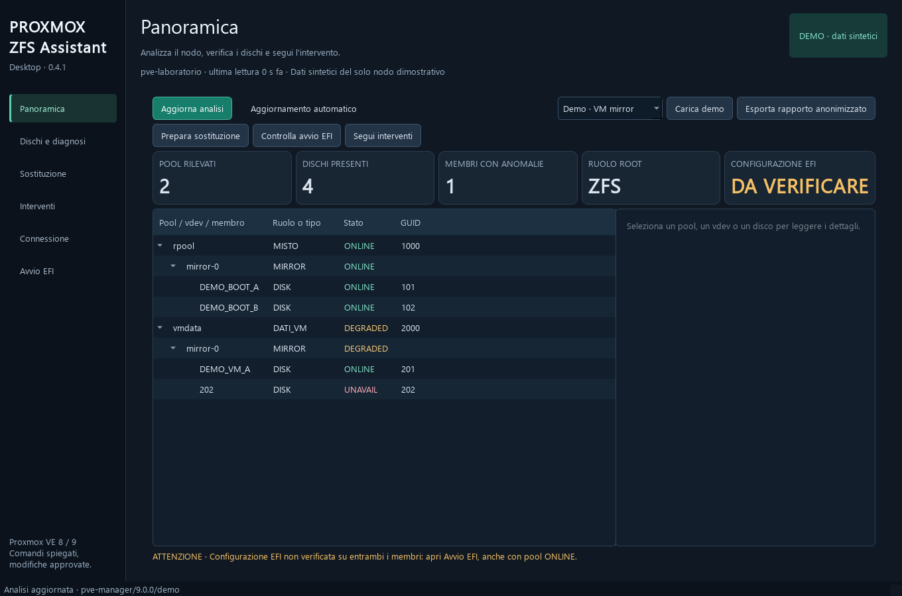
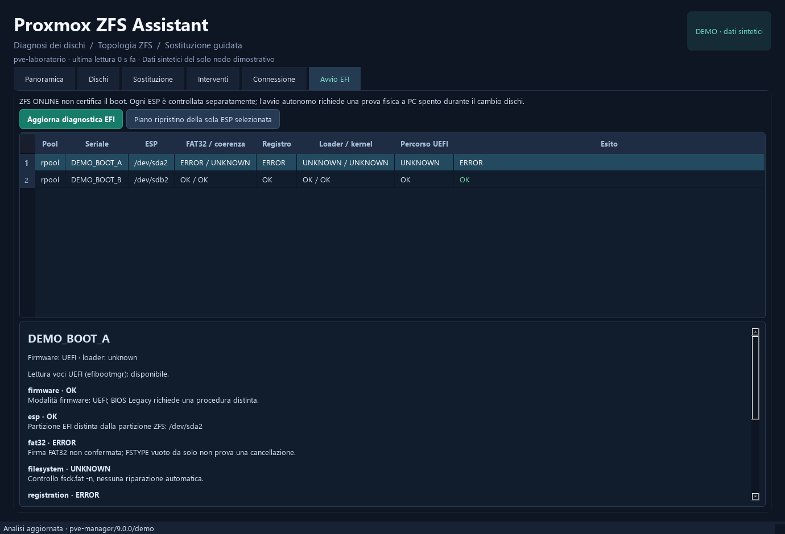

# Proxmox ZFS Assistant

App desktop Windows in Python per diagnosticare dischi e pool ZFS di Proxmox VE 8 e 9 e guidare la sostituzione dei membri guasti. Interfaccia in italiano, collegamento SSH e comandi spiegati prima dell'approvazione. Codice originale con [licenza MIT](LICENSE).

**Versione 0.4.0 da collaudare in laboratorio.** GUI, motore e helper sono implementati e verificati con test automatici e dati sintetici. Non è ancora certificata la compatibilità con server, bootloader o LED reali. Leggi la [matrice di compatibilità](docs/compatibilita.md) prima di usare operazioni modificative.

**Aggiornamento da versioni precedenti:** senza comandi attivi, usa **Installa / aggiorna helper sul nodo** dalla scheda Connessione e ripeti l'analisi. I piani richiedono app e helper della stessa versione. Le correzioni sono elencate nel [changelog](CHANGELOG.md).



## Avvio rapido Windows

In questa cartella esegui `avvia.cmd`. Se parti da un clone nuovo, installa Python 3.10 o successivo ed esegui prima `installa.cmd`. L'app si apre in modalità demo: scegli VM mirror, VM RAIDZ1 oppure EFI non valida dalla Panoramica. In caso di errore di avvio, trovi i dettagli in `%LOCALAPPDATA%\ProxmoxZfsAssistant\startup-error.log`.

Per il pacchetto compilato, estrai l'intero ZIP e avvia `ProxmoxZfsAssistant.exe`. Conserva tutte le librerie e le licenze della distribuzione.

## Novità 0.4.0

- **Inizializza nuova ESP dopo sostituzione disco**, accessibile anche dall'intervento ZFS: piano distinto e conferma esplicita della formattazione.
- Verifica del registro della sostituzione, WWN, seriale e PARTUUID; lettura integrale della ESP, senza dedurre che sia vuota dal solo FSTYPE assente.
- Ripristino di ESP esistenti senza format, gestione separata degli UUID assenti e stato **BOOT_TEST_PENDING** fino alle prove fisiche.

[Procedura completa, aggiornamento e limiti](docs/nuova-esp.md).

## Funzioni introdotte in 0.3.0

- Refresh stabile: pool GUID, dischi, scheda e scorrimento conservati; nessun ripiego su un altro pool se il target scompare.
- GRUB su ZFS: verifica delle entry e dei file nel dataset root; systemd-boot: verifica dei percorsi indicati nelle entry della ESP.
- Ripristino controllato della ESP superstite, senza richiedere un secondo disco già sano; pulizia UUID assenti approvabile dopo ricostruzione e verifica EFI.
- Pool VM con mirror più ampi, RAIDZ1/2/3 e più vdev dati; spare, dRAID, classi ausiliarie e layout non riconosciuti restano bloccati.
- Profili server senza password salvate, modalità sola lettura con dry-run, cronologia locale e rapporti JSON/HTML/PDF anonimizzati.
- Installazione Windows con `py` oppure `python`, messaggi persistenti in caso di errore.

Procedura di collaudo e limiti: [versione 0.3.0](docs/collaudo-0.3.md).

## Funzioni implementate

- Albero pool → vdev → dischi con mirror e livelli RAIDZ rilevati, anche con membri assenti.
- Distinzione boot, VM e ruolo misto tramite filesystem root, partizioni e configurazione storage.
- Inventario, SMART, seriali, posizioni fisiche e storico locale SQLite.
- Piani per boot mirror di due membri e pool VM mirror/RAIDZ1/2/3 anche con più vdev, con controlli sul nodo.
- Gestione GPT ed ESP nei layout boot supportati, con scelta GRUB o systemd-boot rilevata.
- Diagnostica EFI di entrambi i dischi, indipendente dallo stato ONLINE del pool, e ripristino approvato della sola ESP selezionata.
- Fase EFI dopo il resilver, refresh esplicito e completamento boot subordinato a configurazione verificata e prove fisiche su entrambi i membri.
- Esclusione logica guidata del membro problematico prima della rimozione a caldo.
- Percorso con spegnimento obbligatorio per il PC di laboratorio senza hot swap.
- Anteprima dei comandi, approvazione tramite seriale, verifica del ricambio libero e registro persistente.
- Recupero degli interventi e monitoraggio del resilver dopo disconnessioni.
- Identificazione temporizzata solo per LED locate enclosure esposti e associati da sysfs.
- Export anonimizzato e richiesta di chiarimenti se il RAID non è verificabile.

La disponibilità hot swap non implica disponibilità del LED. Su SATA diretto sono previsti seriale ed etichette. Le configurazioni sconosciute, le firme sul ricambio, errori sugli altri membri e le topologie non supportate bloccano le scritture. L'app non forza replace, non distrugge pool e non cancella automaticamente dischi usati.

## Collegamento reale e documentazione

Da Connessione configura SSH, verifica la chiave host, installa esplicitamente l'helper con una sessione root e avvia l'analisi. Le password rimangono in memoria. Il nodo deve già avere gli strumenti richiesti; l'app non installa pacchetti né cambia impostazioni SSH.

La chiave privata è facoltativa se usi la password o un agente SSH. La scheda **Avvio EFI** evidenzia il caso mirror sano con una ESP non valida; l'analisi iniziale non ripara filesystem e non modifica le voci del firmware. La presenza dei file EFI non prova un avvio autonomo: segui le prove fisiche del manuale.



- [Manuale e procedure di sostituzione](docs/manuale.md)
- [Compatibilità e collaudi ancora necessari](docs/compatibilita.md)
- [Creazione del repository pubblico GitHub](docs/github.md)
- [Documento di progetto](PROGETTO.md)
- [Contributi](CONTRIBUTING.md) e [sicurezza](SECURITY.md)
- [Componenti e licenze di terze parti](THIRD_PARTY_NOTICES.md)

Il laboratorio dispone di due dischi VM in mirror. In produzione sono previsti mirror di due dischi o RAIDZ di tre, oltre al boot separato in mirror. Il modello server e il backplane della piattaforma Xeon E-2300 / C252 devono essere verificati per LED e procedura a caldo.

## Sviluppo e build

```powershell
python -m venv .venv
.\.venv\Scripts\python.exe -m pip install -r requirements-dev.txt
$env:PYTHONPATH = 'src'
.\.venv\Scripts\python.exe -m pve_disk_assistant
.\.venv\Scripts\python.exe -m pytest -q
.\.venv\Scripts\python.exe scripts/build_windows.py
```

Il build produce `dist/ProxmoxZfsAssistant-Windows.zip` e il relativo hash. La CI prova Windows e Linux con Python 3.11 e 3.12 e prepara e avvia l'artefatto Windows. Non esegue operazioni su server reali.

Ispirazione funzionale e visiva: [jt-proxense di Jason Cheng](https://github.com/jasoncheng7115/jt-proxense). L'implementazione è autonoma e non incorpora codice o asset del riferimento. Progetto indipendente da Proxmox, non affiliato a Proxmox Server Solutions GmbH.
