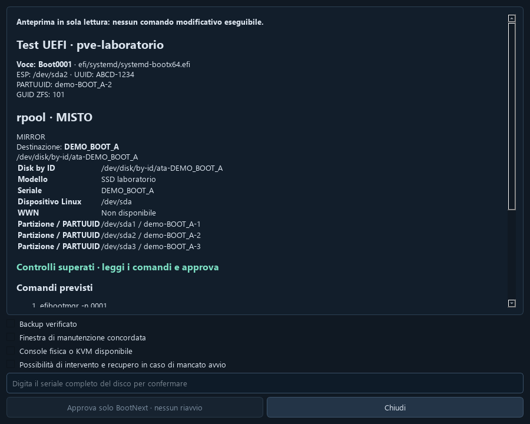

# Identificazione persistente e test UEFI — 0.5.0

## Cosa dimostra il test

Il test UEFI conferma un nuovo avvio del nodo con BootCurrent corrispondente alla voce selezionata e ancora associata al disco/ESP verificati, seguito dai controlli su kernel, ZFS ed EFI. Entrambi i membri del mirror restano collegati. Non dimostra che quel disco possa avviare da solo il sistema: questa rimane una prova fisica distinta e dichiarata dall'operatore in Interventi, con i controlli già presenti nella 0.4.1.

Un test UEFI superato non rimuove BOOT_TEST_PENDING dagli interventi di sostituzione e non compila automaticamente le prove di autonomia. Non vengono eseguiti offline, detach, export/import, format o riparazioni durante il test.

## Aggiornamento

Con nessun comando in corso, aggiornare l'app e usare **Connessione → Installa / aggiorna helper sul nodo**. È richiesta la stessa versione 0.5.0 per GUI e helper prima di piani, test e aggiornamento degli interventi. Il database SQLite preesistente viene esteso con la tabella `uefi_tests`, senza cancellare storico, profili o posizioni.

Alla riconnessione viene riletto l'inventario. Le password restano in memoria: dopo aver chiuso l'app è necessario reinserirle oppure usare una chiave/agente SSH. Il controllo della chiave host rimane attivo anche nei tentativi di riconnessione; una nuova chiave non viene accettata automaticamente.

## Identificazione fisica

Il nodo enumera esclusivamente symlink esistenti in `/dev/disk/by-id`, `/dev/disk/by-partuuid` e `/dev/disk/by-uuid`. `os.path.realpath` risolve i link sul nodo (equivalente alla risoluzione di `readlink -f`); i percorsi osservati vengono correlati all'inventario `lsblk` e ai membri di `zpool status -P/-gP`.

Si preferisce l'alias by-id indipendente contenente il seriale, fra quelli effettivamente osservati sul disco. WWN duplicati producono un avviso: il WWN condiviso non costituisce una prova di identità. Servono seriale univoco e alias indipendente verificato. Seriale, alias selezionato o PARTUUID ambigui bloccano le scritture; la diagnostica resta disponibile. Per il test UEFI il WWN può essere assente se seriale e alias indipendente sono verificati. Le ulteriori prove richieste dalla procedura di inizializzazione ESP restano in vigore.

Il percorso Linux resta visibile, ma non è l'identità persistente. Nel test post-riavvio può cambiare `/dev/sdX`: il vincolo confronta nodo, pool/GUID membro, by-id, seriale, modello, capacità, WWN disponibile, UUID/PARTUUID ESP e voce/file UEFI. Il nome Linux non fa parte di questo confronto. Un nuovo alias scelto come preferito non cancella gli alias osservati né lo storico; i vecchi riferimenti WWN sono confrontati con gli alias attuali quando ancora verificabili.

La GUI mostra i percorsi completi nei dettagli e nei tooltip, con **Copia Disk by ID**. Le tabelle possono essere scorse orizzontalmente. La mappatura non richiede di cambiare i nomi memorizzati nel pool. I percorsi di partizioni future mostrati dai vecchi piani di sostituzione restano comandi prospettici e vengono verificati sul nodo dopo la creazione GPT; non sono presentati come identità già rilevate.

## Procedura dalla GUI

1. Collegarsi al nodo e aggiornare l'analisi. In **Avvio EFI** selezionare il disco fisico. Leggere modello, seriale, by-id, partizioni, UUID/PARTUUID, loader, file e voce UEFI. Il riepilogo in Panoramica distingue stato ZFS, configurazione EFI e ultimo test.
2. **Verifica avviabilità** prepara una diagnostica senza modificare il firmware. **Prova avvio da questo disco** ripete la diagnostica e apre il piano approvabile. Se più voci attive corrispondono alla stessa ESP, selezionare esplicitamente quale provare. Una voce assente o non verificabile non viene creata o indovinata.
3. Leggere il piano. Occorrono mirror root di due membri ONLINE senza errori o attività di ricostruzione/scrub, GPT/ESP distinte da ZFS, registrazione Proxmox valida, file EFI leggibili e supportati. La diagnostica non smonta ESP già montate e non effettua riparazioni. Configurazioni non supportate producono un blocco esplicito.
4. Confermare separatamente backup, manutenzione, console fisica/KVM e possibilità di recupero. Digitare il seriale completo. **Approva solo BootNext** invia unicamente `efibootmgr -n XXXX`, dove XXXX proviene dalla voce verificata. Il nodo rilegge inventario e identità prima della scrittura e verifica poi BootNext e BootOrder. Un BootNext già presente non viene sovrascritto.
5. L'app non riavvia in questa fase. Il test passa a **BootNext verificato · riavvio da approvare**. Se il firmware rifiuta il comando o la risposta è incerta, usare la verifica; il comando non viene reinviato automaticamente.
6. Fermare VM/CT attraverso Proxmox. Selezionare il test nello storico e premere **Approva riavvio per il test selezionato**. Una seconda finestra richiede conferma e mostra `shutdown -r +1`, nodo, disco e voce. Il nodo rivalida tutto, blocca cluster/HA e carichi ancora accesi, salva l'intenzione e richiede il riavvio fra un minuto. SSH verrà interrotto.
7. L'app tenta la riconnessione in sola lettura ogni 20 secondi, quando non è occupata. Ogni richiesta SSH ha un timeout; le operazioni modificative non vengono ripetute. Alla riconnessione controlla identità del nodo, nuovo boot ID, BootCurrent, voce/PARTUUID/file, kernel Proxmox, membri/errori del mirror e configurazione delle ESP.
8. Se l'app è stata chiusa, ricollegarsi al medesimo nodo: lo storico locale recupera i test in sospeso. **Verifica post-riavvio / recupera test** recupera anche i test dal registro protetto sul nodo. Per una connessione in sola lettura si possono consultare diagnostica e registri, ma non richiedere aggiornamenti del registro operativo sul nodo.
9. Aprire **Dettagli / storico test** per dati prima/dopo, conferme, comandi, exit code ed errori. **Esporta report** include lo storico nei formati JSON, HTML e PDF anonimizzati già presenti. Le identità complete restano consultabili nella GUI e nel database locale; non vengono salvate credenziali SSH nei record dei test.

## Esiti

| Stato visibile | Significato |
| --- | --- |
| Test UEFI non eseguito | Solo piano, nessun BootNext approvato |
| Impostazione BootNext da verificare | Intenzione salvata; scrittura non ancora riconciliata |
| BootNext verificato · riavvio da approvare | Variabile verificata, riavvio ancora da autorizzare |
| Riavvio richiesto · verifica in attesa | Intenzione persistente; nessuna ripetizione del reboot |
| Test UEFI superato | Nuovo boot, voce/identità coerenti e verifiche ZFS/EFI/kernel positive |
| Test UEFI non confermato | Altra voce utilizzata o associazione del disco/ESP cambiata |
| Test UEFI fallito | Rifiuto di BootNext confermato dalla rilettura, oppure boot dalla voce richiesta con controlli successivi non superati |
| Esito non determinato | SSH assente, errore di raccolta, identità nodo diversa, variabili illeggibili o esito ancora incerto |

Il firmware può cambiare BootOrder dopo il riavvio. L'app conserva i valori prima/dopo e l'indicatore `boot_order_changed`, senza inviare `efibootmgr -o`. Se BootOrder cambia già durante l'impostazione di BootNext, il riavvio dall'app rimane bloccato. L'operatore deve verificare la situazione tramite console; non viene tentato un ripristino implicito.

Un test in sospeso impedisce l'avvio di un altro test o di una modifica ai dischi. Prima di proseguire recuperare il suo esito. Lo storico locale non sostituisce il registro sul nodo e non autorizza scritture: l'helper rivalida sempre stato e conferme.

## Collaudo e limiti

La suite di regressione copre i 20 scenari richiesti: WWN duplicati e seriali differenti, cambio nome Linux, risoluzione/mancanza/ambiguità by-id, correlazione ESP, voce errata, file assente, BootNext accettato/rifiutato, BootCurrent uguale/diverso, perdita SSH, chiusura app, BootOrder variato, ZFS degradato, loader sconosciuto, conferme mancanti, identità cambiata ed export dei report. A questi si aggiungono test di non ripetizione, separazione dall'autonomia fisica, compatibilità helper e salvataggio dell'intenzione prima del comando.

Le fixture riproducono la struttura del caso segnalato con identificativi sintetici; nessun seriale, indirizzo o UUID reale è incluso. Le prove automatiche non certificano il comportamento di ogni firmware o l'effettivo avvio su hardware. Il caso reale comunicato dall'operatore è un riferimento funzionale, non un collaudo della build 0.5.0.

Prima dell'uso operativo verificare su un laboratorio: GRUB e systemd-boot, entrambi i membri, rifiuto firmware, timeout/chiusura app, BootOrder variato, ripristino manuale tramite console e separata autonomia fisica. Registrare versioni Proxmox/OpenZFS/kernel, firmware, bootloader e Secure Boot. L'app non certifica le firme Secure Boot né supporta layout proprietari che non siano verificabili.

Riferimento per le variabili firmware: [manuale efibootmgr di Debian](https://manpages.debian.org/trixie/efibootmgr/efibootmgr.8.en.html). BootNext seleziona una voce per il prossimo avvio; BootCurrent identifica la voce usata. L'app legge BootOrder ma non ne richiede la modifica.

## Moduli

`identity.py` gestisce confronti e avvisi; `boot.py` raccoglie le prove EFI; `uefi.py` contiene diagnostica e classificazione dell'esito; `uefi_service.py` applica controlli, lock e registro sul nodo. `ui_uefi.py` collega le azioni alle schermate esistenti e gestisce la riconnessione in sola lettura. `store.py` conserva lo storico locale senza alterare i database precedenti.
